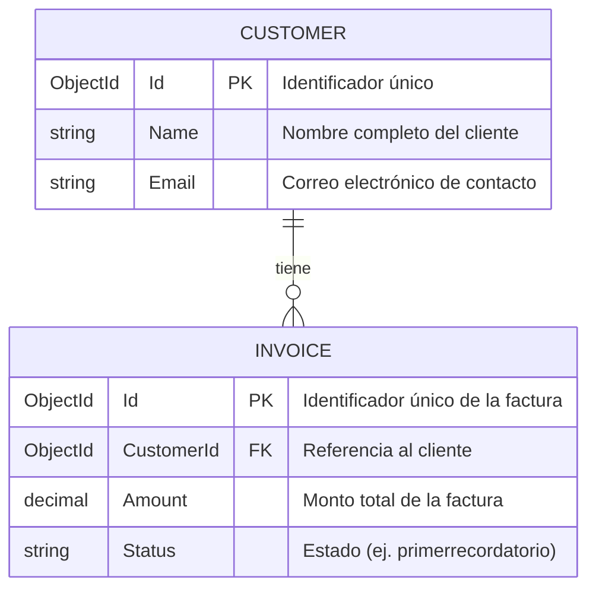

---


###  Lógica de Negocio y Arquitectura de Servicios

El backend de la aplicación implementa una arquitectura modular basada en servicios especializados que gestionan la interacción con la base de datos y el envío de notificaciones:

#### 1. Gestión de Clientes (`CustomerService`)

* **Consulta General (`GetAllAsync`)**: Se conecta a la colección de clientes en MongoDB para recuperar el listado completo de registros disponibles en el sistema.


* **Búsqueda por ID (`GetByIdAsync`)**: Permite consultar la información detallada de un cliente específico utilizando su identificador único de tipo `ObjectId`.


#### 2. Gestión y Procesamiento de Facturas (`InvoiceService`)

* **Consulta de Facturas**: Proporciona métodos para listar todas las facturas del sistema o filtrarlas de manera específica por el identificador del cliente (`customerId`).


* **Automatización de Cobros y Recordatorios (`ProcessRemindersByCustomerAsync`)**:
* Obtiene las facturas asociadas a un cliente.


* Itera sobre cada registro validando el estado del recordatorio.


* Desencadena de forma automatizada el envío de notificaciones por correo electrónico a través del servicio de mensajería para aquellas facturas que requieran atención del cliente.


* Retorna el conteo total de facturas procesadas exitosamente.

#### 3. Servicio de Notificaciones y Correo (`EmailService`)

* **Proveedor y Conexión SMTP Segura**: Utiliza el servicio de retransmisión de correo de **`smtp-relay.brevo.com`** mediante protocolos seguros (`StartTls`), incorporando prácticas estándar para entornos en contenedores o en la nube que aseguran la compatibilidad del envío sin comprometer la validación de certificados del sistema.


* **Construcción de Mensajes HTML**: Genera de manera dinámica correos electrónicos formateados en HTML (incluyendo remitente, destinatario, asunto y cuerpo del mensaje) para notificar formalmente a los clientes sobre el estado de sus facturas.

###  Esquema de Base de Datos (MongoDB)

La aplicación utiliza una base de datos NoSQL con dos colecciones principales:

#### 1. Colección: `customers`

Almacena la información básica de los clientes registrados en el sistema.

* **`_id`**: Identificador único del cliente de tipo `ObjectId` (Clave primaria).


* **`name`**: Nombre completo del cliente (`string`).


* **`email`**: Correo electrónico de contacto del cliente (`string`).


#### 2. Colección: `invoices`

Almacena los detalles de las facturas y el estado de sus respectivos recordatorios.

* **`_id`**: Identificador único de la factura de tipo `ObjectId` (Clave primaria).


* **`customerId`**: Identificador de tipo `ObjectId` que realiza la relación (Foreign Key) con la colección `customers`.


* **`amount`**: Monto total de la factura de tipo numérico (`decimal`).


* **`status`**: Estado actual del proceso de cobro o notificación de la factura (`string`, por defecto: `"primerrecordatorio"`).




###  Endpoints de la API

La API expone dos controladores principales para gestionar los clientes y las facturas/recordatorios:

#### 1. Customers (`/api/customers`)

* **`GET /api/customers`**
* **Descripción**: Obtiene la lista completa de todos los clientes registrados.


* **Respuesta exitosa (`200 OK`)**: Retorna un arreglo JSON con los datos de los clientes (ID, nombre y correo).


* **`GET /api/customers/{id}`**
* **Descripción**: Busca y retorna la información de un cliente específico según su identificador único.


* **Parámetro de ruta**: `id` (ObjectId del cliente).


* **Respuesta exitosa (`200 OK`)**: Retorna el objeto del cliente.


* **Respuesta de error (`404 Not Found`)**: Si el cliente no existe en la base de datos.


#### 2. Invoices (`/api/invoices`)

* **`GET /api/invoices`**
* **Descripción**: Obtiene la lista de todas las facturas registradas en el sistema.


* **Respuesta exitosa (`200 OK`)**: Retorna un arreglo con todas las facturas y sus estados.


* **`GET /api/invoices/customer/{customerId}`**
* **Descripción**: Consulta todas las facturas asociadas a un cliente en específico mediante su `customerId`.


* **Parámetro de ruta**: `customerId` (ObjectId del cliente).


* **Respuesta exitosa (`200 OK`)**: Retorna las facturas del cliente consultado.


* **`POST /api/invoices/process-reminders/{customerId}`**
* **Descripción**: Procesa y dispara de forma automatizada el envío de correos electrónicos de recordatorio para las facturas asociadas al cliente indicado.


* **Parámetro de ruta**: `customerId` (ObjectId del cliente).


* **Respuesta exitosa (`200 OK`)**: Retorna un mensaje confirmando el éxito del proceso, el ID del cliente y la cantidad de facturas procesadas/notificadas.


###  Cómo visualizar y probar la API con Swagger

La interfaz gráfica interactiva de Swagger está integrada para documentar y probar cada uno de los endpoints de manera visual:

1. **Ejecutar la aplicación**:
* Ubícate en la carpeta del proyecto backend y ejecuta el comando:
```bash
dotnet run --project InvoiceApi/InvoiceApi.csproj

```


2. **Abrir Swagger en el navegador**:
* Una vez iniciado el servidor, abre tu navegador web y dirígete a la URL local provista por la consola (`http://localhost:5085/swagger`).


3. **Probar los endpoints interactivamente**:
* Haz clic sobre cualquiera de los métodos listados (por ejemplo, `GET /api/customers` o `POST /api/invoices/process-reminders/{customerId}`).
* Presiona el botón **"Try it out"**.
* Si el endpoint requiere parámetros (como un `id` o `customerId`), completa el campo de texto con un identificador válido (puedes usar los IDs provistos en el script de inicialización de la base de datos, como `650000000000000000000001`).


* Haz clic en **"Execute"** para enviar la petición y visualizar la respuesta HTTP, el código de estado y el cuerpo JSON devuelto en tiempo real.

Aquí tienes la sección de **Code Coverage** (Cobertura de Código) completa para integrar en tu README, detallando tanto los comandos de ejecución como los reportes de cobertura obtenidos para el Backend (.NET) y el Frontend (Angular/Jasmine):


### Code Coverage (Cobertura de Código)

El proyecto cuenta con un riguroso conjunto de pruebas unitarias tanto en el backend como en el frontend, alcanzando altos porcentajes de cobertura en declaraciones, ramas y líneas.

#### 1. Backend (.NET 10.0 - xUnit & Moq)

Las pruebas del backend evalúan los controladores, servicios de negocio y middlewares de manejo de excepciones.

* **Comando de ejecución**:
```bash
cd backend/FacturasApi.Tests/
dotnet test --collect:"XPlat Code Coverage" --settings coverlet.runsettings

```


* **Resumen de Cobertura**:
* **Cobertura de Líneas Global**: **`96.57%`** (141 de 146 líneas cubiertas).


* **Cobertura de Ramas (Branch Coverage)**: **`100%`**.


* **Componentes Validados**: `CustomerService`, `InvoiceService`, `EmailService`, `CustomersController`, `InvoicesController` y `ExceptionMiddleware`.


#### 2. Frontend (Angular - Jasmine & V8)

Las pruebas del frontend validan los componentes visuales, selectores y servicios de cliente.

* **Comando de ejecución**:
```bash
cd frontend/
npm run test:coverage

```


* **Resumen de Cobertura (V8 Report)**:
* **Statements (% Stmts)**: **`94.4%`**
* **Branches (% Branch)**: **`93.44%`**
* **Functions (% Funcs)**: **`78.94%`**
* **Lines (% Lines)**: **`95.78%`**


* **Detalle por Módulos**:
* `app / app.ts`: **100%** de cobertura en todas las métricas.
* `app/core/services / invoice.service.ts`: **100%** de cobertura.
* `app/features/invoices/components`: **98.57%** de statements y **100%** de líneas (`invoice-table` y `client-selector`).
* `app/features/invoices/pages / invoice-dashboard.component.ts`: **90.69%** de cobertura general de líneas.


###  Instrucciones de Ejecución

Sigue estos pasos para poner en marcha todo el sistema de manera local:

#### 1. Levantar la Base de Datos (MongoDB)

El proyecto incluye una configuración de Docker Compose para desplegar la base de datos MongoDB junto con el script de inicialización de datos de prueba (`init-mongo.js`).

* Ubícate en la **carpeta raíz** del proyecto y ejecuta:


```bash
docker compose up -d

```


#### 2. Ejecutar el Backend (.NET)

El servicio de la API se encuentra dentro de la carpeta del backend.

* Ubícate en la carpeta del proyecto API (`backend/InvoiceApi/`):


```bash
cd backend/InvoiceApi/

```


* Ejecuta la aplicación con el comando de .NET:
```bash
dotnet run

```


* El servidor iniciará de forma local y podrás acceder a la documentación interactiva de Swagger en tu navegador en:
👉 **`https://localhost:5085/swagger`**

#### 3. Ejecutar el Frontend (Angular)

El cliente web está desarrollado con Angular y se ejecuta en un servidor de desarrollo local.

* Abre una nueva terminal, ubícate en la carpeta `frontend/` y arranca la aplicación:
```bash
cd frontend/
npm install
ng serve

```


* Una vez compilado, abre tu navegador web y accede a la interfaz de usuario ingresando a:
http://localhost:4200/

---
